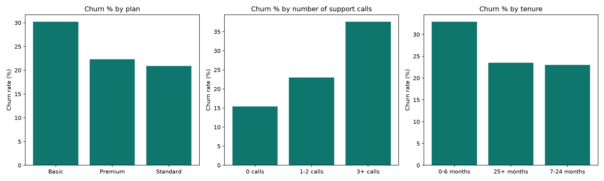

#  Telecom Customer Churn Analysis

##  Project Overview

This project analyzes **telecom customer churn** to understand why customers leave a service and which customer segments are at higher risk of churning.

The project uses **Python for data cleaning and preparation** and **SQL for analysis**, with visualizations created using Python's Matplotlib library.

> **Important:** This project uses **simulated data** created for learning and portfolio purposes. The findings should not be interpreted as representing a real telecom company's customers or business performance.

---

##  Business Problem

Customer churn is an important business problem for telecom companies because losing customers can reduce recurring revenue and increase the cost of acquiring new customers.

The main questions this project investigates are:

* What is the overall customer churn rate?
* Which subscription plans have the highest churn?
* Does the number of customer support calls relate to churn?
* Which tenure group is most at risk?
* Which payment methods have higher churn rates?
* Which states have the greatest monthly revenue loss from churn?
* Which combinations of plan and support-call frequency represent the highest-risk customer segments?

---

##  Tools 

* **Python**

  * Pandas
  * Matplotlib
  * SQLite
* **SQL**

  * `CASE`
  * `GROUP BY`
  * `HAVING`
  * Window functions
  * `RANK()`
* **VS Code**
* **Git & GitHub**

---

## Data Cleaning

The original dataset contained several data-quality issues that were cleaned using Python.

The cleaning process included:

* Removing duplicate records
* Removing customers with missing churn labels
* Removing records with negative tenure
* Standardizing inconsistent Yes/No values such as `Yes`, `yes`, `Y`, `No`, and `N`
* Cleaning currency values stored as text, including ₦ symbols
* Standardizing state names
* Standardizing subscription plan names
* Filling missing data-usage values
* Preparing the cleaned dataset for SQL analysis

### Cleaning Results

| Cleaning Step                |             Records |
| ---------------------------- | ------------------: |
| Duplicate rows removed       |                  50 |
| Missing churn labels removed |                  38 |
| Negative tenure rows removed |                  49 |
| Missing data usage filled    |                  94 |
| Final clean dataset          | **1,913 customers** |

---

##  Key Findings

### Overall Churn

The cleaned dataset contains **1,913 customers**, of which **470 churned**.

**Overall churn rate: 24.6%**

---

###  Churn by Subscription Plan

| Plan     | Customers | Churn Rate |
| -------- | --------: | ---------: |
| Basic    |       655 |  **30.2%** |
| Premium  |       660 |      22.3% |
| Standard |       598 |      20.9% |

The Basic plan recorded the highest churn rate at **30.2%**, compared with 22.3% for Premium and 20.9% for Standard.

---

### Churn by Customer Support Calls

| Support Calls | Customers | Churn Rate |
| ------------- | --------: | ---------: |
| 0 calls       |       583 |      15.4% |
| 1–2 calls     |       825 |      23.0% |
| 3+ calls      |       505 |  **37.6%** |

One of the strongest patterns in the analysis is the relationship between **support-call frequency and churn**.

Customers with **3 or more support calls had a 37.6% churn rate**, compared with only **15.4% among customers with no support calls**.

This represents a substantial difference and suggests that repeated customer support interactions may be an important signal for identifying customers who are at higher risk of leaving.

> This is an observed relationship in the simulated dataset, not proof that support calls themselves cause churn.

---

###  Churn by Customer Tenure

| Tenure Group | Customers | Churn Rate |
| ------------ | --------: | ---------: |
| 0–6 months   |       252 |  **32.9%** |
| 7–24 months  |       716 |      23.0% |
| 25+ months   |       945 |      23.5% |

Customers in their first six months had the highest churn rate at **32.9%**.

This suggests that the early customer lifecycle may deserve particular attention when designing onboarding and retention strategies.

---

### Churn by Payment Method

| Payment Method | Customers | Churn Rate |
| -------------- | --------: | ---------: |
| Card           |       492 |      25.8% |
| Cash           |       505 |      25.5% |
| USSD           |       442 |      23.5% |
| Transfer       |       474 |      23.2% |

The differences between payment methods were relatively smaller than the differences observed across plans, support-call groups, and tenure.

---

##  Monthly Revenue Lost to Churn

The analysis also examined estimated monthly revenue lost from churn by state.

| Rank | State  | Monthly Revenue Lost |
| ---: | ------ | -------------------: |
|    1 | Osun   |             ₦633,000 |
|    2 | Oyo    |             ₦531,000 |
|    3 | Lagos  |             ₦510,000 |
|    4 | Kano   |             ₦495,000 |
|    5 | Abuja  |             ₦492,000 |
|    6 | Rivers |             ₦447,000 |

Osun recorded the highest estimated monthly revenue loss from churn in this simulated dataset at **₦633,000**.

---

## 🚨 Highest-Risk Customer Segments

The analysis combined **subscription plan** and **support-call frequency** to identify higher-risk segments.

| Plan     | Support Group | Customers | Churn Rate |
| -------- | ------------- | --------: | ---------: |
| Basic    | 3+ calls      |       176 |  **40.3%** |
| Standard | 3+ calls      |       151 |      37.7% |
| Premium  | 3+ calls      |       178 |      34.8% |
| Basic    | 0–2 calls     |       479 |      26.5% |
| Premium  | 0–2 calls     |       482 |      17.6% |

The **Basic + 3+ support calls** segment had the highest observed churn rate at **40.3%**.

This demonstrates why looking at combinations of customer characteristics can provide more useful insights than analyzing individual variables separately.

---

## Visualizations

The Python script generates a chart image containing three visualizations:

1. Churn rate by subscription plan
2. Churn rate by number of support calls
3. Churn rate by customer tenure

The generated visualization is saved as:


()
```

---

##  SQL Analysis

The project stores the cleaned data in a SQLite database:

```text
churn.db
```

SQL was used to:

* Calculate overall churn
* Group customers into categories using `CASE`
* Calculate churn rates by different customer attributes
* Filter grouped results using `HAVING`
* Rank states based on revenue lost from churn
* Identify high-risk combinations of plan and support-call frequency
* Analyze customer segments rather than relying only on overall averages

---

##  Project Structure

```text
churn-project/
│
├── churn_project.py
├── clean_churn.csv
├── churn.db
├── churn_charts.png
└── README.md
```

### Files

**`churn_project.py`**
Python script responsible for cleaning the data, performing the analysis, creating the SQLite database, and generating charts.

**`clean_churn.csv`**
The cleaned customer dataset produced by the Python pipeline.

**`churn.db`**
SQLite database containing the data used for SQL analysis.

**`churn_charts.png`**
Visualization containing the main churn charts.

**`README.md`**
Documentation explaining the project, methodology, findings, and results.

---

## 🔄 Project Workflow

```text
Raw Customer Data
        ↓
Python Data Cleaning
        ↓
Clean Customer Dataset
        ↓
SQLite Database
        ↓
SQL Analysis
        ↓
Customer Segmentation
        ↓
Churn Insights
        ↓
Python Visualizations
```

---

## 💡 Business Insights

Based on the simulated dataset, several patterns stand out:

### 1. Support interactions are an important churn signal

Customers with 3+ support calls had a substantially higher churn rate than customers with no support calls.

A telecom company could therefore monitor repeated support interactions as a potential **customer-risk indicator**.

### 2. Early-tenure customers require attention

The 0–6 month group had a 32.9% churn rate, suggesting that the early customer journey could be an important area for retention analysis.

### 3. Basic-plan customers showed higher churn

The Basic plan had the highest overall churn rate among the three plans analyzed.

### 4. Combining variables reveals stronger patterns

The Basic + 3+ support calls segment had a 40.3% churn rate.

This demonstrates the value of **customer segmentation** instead of looking at each variable independently.

---

##  Possible Business Recommendations

Based on the patterns observed in this simulated dataset, a telecom company could consider:

* Creating an early-tenure customer retention programme
* Monitoring customers with repeated support interactions
* Investigating recurring issues behind multiple support calls
* Reviewing the customer experience associated with the Basic plan
* Creating targeted retention campaigns for higher-risk segments
* Monitoring churn-related revenue loss by geographic area
* Using customer data to build a churn-risk dashboard

These recommendations would need to be validated with real customer data before being implemented in a real business environment.

---

##  What I Learned

Through this project, I practiced:

* Cleaning real-world-style messy datasets with Python
* Handling missing and inconsistent data
* Working with Pandas
* Building SQL queries for business analysis
* Using `CASE` statements for customer segmentation
* Using `HAVING` to filter aggregated results
* Applying SQL window functions such as `RANK()`
* Creating data visualizations with Matplotlib
* Converting business questions into measurable analytical questions
* Communicating data findings as business insights

---

## Conclusion

This project demonstrates a complete beginner-to-intermediate data analytics workflow:

**Data Cleaning → SQL Analysis → Segmentation → Visualization → Business Insights**

The analysis shows that churn is not evenly distributed across customers. In this simulated dataset, support-call frequency, tenure, subscription plan, and combinations of these factors reveal meaningful differences in churn rates.

The project highlights how data analysts can move beyond simply reporting numbers and use customer data to identify patterns that can support business decision-making.

---

## Author

**Akinniyi Anuoluwa**

Computer Science Student | Data Analyst

Skills demonstrated in this project:

**Python • Pandas • SQL • SQLite • Data Cleaning • Data Analysis • Matplotlib • Customer Analytics**
